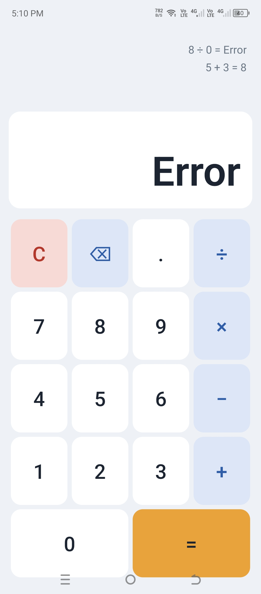

# React Native Calculator

A simple calculator mobile app built with React Native (Expo) for the **Simple React Native UI Activity**.

**Name:** Axel Dave R. Nuyda
**Program:** DIT, PUP Unisan Campus

## What the App Does

- Shows the numbers being typed and the result on a display screen
- Has buttons for digits 0-9 and a decimal point
- Supports addition (+), subtraction (−), multiplication (×), and division (÷)
- Has an equals (=) button to compute the answer
- Has a Clear (C) button and a backspace (⌫) button
- Shows "Error" when dividing by zero
- Does not use `eval()` or any UI library

### Bonus Features

- **Dark mode**: the colors change automatically based on the phone's theme (`useColorScheme`)
- **Calculation history**: past calculations are listed above the display

## React Native Concepts Used

- **Core components:** `View`, `Text`, `Pressable`, `FlatList`
- **Components (4):** `Display`, `CalcButton`, `History`, `Calculator`
- **Props:** data such as labels, colors, and the press handler are passed to child components
- **State:** `useState` stores the current value, the previous number, the operator, and the history
- **Events:** `onPress` handles button taps
- **Rendering lists:** `.map()` creates the buttons and `FlatList` shows the history
- **Styling:** all styles use `StyleSheet.create()`; the buttons are arranged in a grid with Flexbox (`flexDirection`, `flexWrap`)
- **Press feedback:** a button changes color and shrinks slightly when pressed
- Functional components only

## How to Run

### Option 1: With a computer

1. Create the project: `npx create-expo-app MyApp`
2. Replace the contents of `App.js` in `MyApp` with the `App.js` from this repository
3. Run: `cd MyApp` then `npx expo start`
4. Open the app on your phone with **Expo Go** (scan the QR code), or use an emulator

### Option 2: Phone only (Expo Snack)

1. Open https://snack.expo.dev in a browser
2. Paste the code from `App.js` into the editor
3. Open the Snack in the **Expo Go** app. The Expo Go version must match the Snack's SDK version (SDK 54 was used for this project)

**Snack link:** https://snack.expo.dev/@aexel_dave/a_d-works-

## Screenshot

